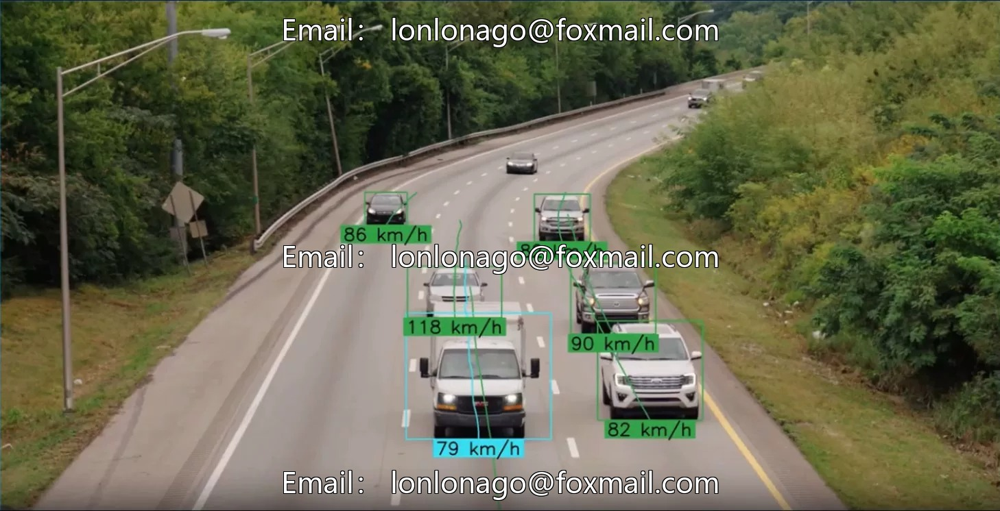

# Vehicle recognition and speed measurement code based on YOLO, supporting multi-object vehicle detection and speed measurement.

## Body

Vehicle recognition and speed measurement code based on YOLO, supporting multi-object vehicle detection and speed measurement, suitable for autonomous driving, traffic monitoring, intelligent transportation, etc. The code is based on the YOLO object detection framework and can be directly run, suitable for computer vision-related research and project development.

Virtual materials, once sold, are non-refundable.
Interested friends, click "I want" to proceed.

## Images

## Payment

Here is a pay link on Stripe ( https://buy.stripe.com/3cs8yP7sY87d0vu9AB ). Please contact me lonlonago@foxmail.com after funding $89, and I will send you a complete data files , thank you!

